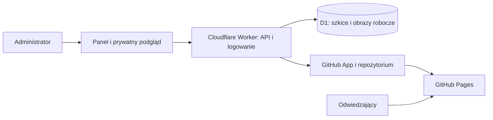

# 001 — Proponowana architektura

Status: przyjęty kierunek realizacji; docelowe rozwiązanie jeszcze niewdrożone. Rozpoczęto lokalny fundament etapu 0, bez zdalnej konfiguracji i migracji publicznych danych. [Stan lokalny](../current/local-development.md).

## Elementy rozwiązania



| Element | Odpowiedzialność |
| --- | --- |
| GitHub Pages | Publiczny HTML/CSS/JS, opublikowany JSON i obrazy; bez połączenia z API panelu |
| Panel HTML/CSS/JS | Listy, formularze, podgląd, stan zapisu i publikacji; zasoby serwowane przez Workera |
| Cloudflare Worker | API, sesje, autoryzacja, szkice, uploady i publikacja |
| Cloudflare D1 | Prywatny magazyn szkiców, małych obrazów roboczych, sesji i operacji publikacji |
| GitHub App | Dostęp tylko do repozytorium AboutMe; zapis opublikowanej treści i odczyt statusu wdrożenia |

Panel i API działają pod jednym originem, bez obowiązkowej własnej domeny. Publiczna strona pozostaje niezależna od zaplecza. Rekomendacja: moduły JavaScript i wspólne renderery bez frameworka, TypeScript dla Workera, migracje SQL, Wrangler do pracy lokalnej i wdrożeń. Node.js LTS jest potrzebny deweloperowi, nie administratorowi używającemu panelu.

## Model danych

Przenieść wykonywalny `data.js` do `content/published.json`: `schemaVersion`, `revision`, `profile`, `projects`, `items`, `quotes`. Zachować treści i identyfikatory biblioteki; dodać trwałe ID projektów i cytatów. Usunąć duplikat `buttonText` bez zmiany publicznej treści.

Po migracji strona ładuje JSON przez `fetch`. Rozwój lokalny wymaga HTTP, np. Live Server; otwieranie przez `file://` przestaje być wspieraną metodą.

Repozytorium jest źródłem opublikowanego stanu, D1 źródłem szkiców. Zapis szkicu nie zmienia repozytorium. Profil i kontakt są jednym rekordem profilu, publikowanym razem; brak operacji usunięcia całego profilu.

| Tabela D1 | Dane |
| --- | --- |
| `drafts` | Typ, stabilne ID, payload, wersja szkicu, daty zapisu |
| `assets` | Prywatny BLOB, MIME, wielkość, hash, powiązanie ze szkicem |
| `sessions` | Hash identyfikatora sesji, administrator, termin wygaśnięcia |
| `publications` | ID operacji, snapshot publikowanej wersji, commit SHA, status, błąd |

## Bezpieczeństwo

- Logowanie GitHub App, jednorazowy `state`, kontrola callbacku, wymiana kodu po stronie Workera.
- Weryfikacja niezmiennego numerycznego GitHub user ID administratora przy każdej sesji. Samo posiadanie konta GitHub nie daje dostępu.
- Cookie sesji `HttpOnly`, `Secure`, `SameSite=Lax`, wygaśnięcie i unieważnienie przy wylogowaniu.
- Autoryzacja wszystkich endpointów prywatnych, kontrola CSRF/Origin dla zapisu, ograniczanie żądań, walidacja danych na serwerze.
- Klucz i sekret aplikacji wyłącznie w sekretach Workera. Tokeny nie trafiają do przeglądarki, Git ani logów.
- GitHub App: Contents read/write, Metadata read, odczyt Pages; odczyt Actions tylko jeśli potrzebny do powiązania wdrożenia z SHA. Bez uprawnienia edycji workflow. Potwierdzić wymagany zestaw w próbie integracyjnej.
- Odpowiedzi prywatne mają `Cache-Control: no-store`; brak treści szkiców w logach i analityce.

## Obrazy i limity kosztowe

Dla małej osobistej strony proponuję małe obrazy robocze jako BLOB w D1, a opublikowane pliki w repozytorium i Pages. To kompromis dla tego wydania, nie rozwiązanie dla dużych galerii.

Proponowane limity aplikacji: wejściowy plik do 10 MB, dłuższy bok po zmniejszeniu do 1600 px, wynik do 512 KiB, łącznie do 50 MiB roboczych obrazów. JPEG/PNG/WebP, bez SVG i animacji. Przeglądarka skaluje i ponownie koduje obraz; API sprawdza wielkość, sygnaturę i podstawowe parametry. Jeśli formatu HEIC nie obsłuży docelowy telefon/przeglądarka, pokazać instrukcję eksportu do JPEG; nie zakładać pełnego wsparcia bez testu.

Obrazy robocze czytane tylko z sesją. Przy publikacji plik trafia do `assets/content/<hash>.<ext>`, a JSON otrzymuje względny adres. Treść i obraz publikowane w jednym commicie. Porządkować nieużywane prywatne zasoby; nie usuwać plików należących do aktywnej publikacji.

Przy URL obraz pozostaje u zewnętrznego dostawcy. Podgląd wykonuje do niego żądanie, o czym panel informuje. Backend nie pobiera dowolnych URL.

Sprawdzone 2026-11-15: Workers Free ma limit 100 tys. żądań dziennie i 10 ms CPU na żądanie. D1 Free oferuje 500 MB na bazę, 5 GB łącznie, 5 mln odczytanych i 100 tys. zapisanych wierszy dziennie. Dlatego przetwarzanie obrazów odbywa się w przeglądarce. Po osiągnięciu darmowego limitu panel może odmówić operacji; publiczna strona działa dalej. Nie włączać automatycznie planu płatnego.

Próba techniczna musi potwierdzić dostępność darmowych usług dla konta, limit CPU podpisywania tokenów i zapis pliku 512 KiB. Nie obiecujemy nieograniczonej darmowej usługi. R2 lub inny magazyn nie wchodzą do bazowej propozycji; ewentualna zmiana wymaga przeglądu kosztów i warunków.

## Prywatny podgląd

Wspólne renderery i style strony przyjmują snapshot opublikowanych danych z nałożonym wyłącznie bieżącym formularzem. Inne szkice nie są dołączane. Podgląd biblioteki przelicza statystyki i ranking. Podgląd działa na originie panelu; szkic nie trafia do publicznego iframe, parametrów adresu ani Pages.

## Publikacja i usuwanie

1. Zwalidować i utrwalić bieżący formularz oraz unikalne ID operacji.
2. Pobrać najnowszy publiczny JSON i podmienić tylko wskazany rekord. Nie eksportować wszystkich szkiców.
3. Utworzyć atomowy commit JSON + obrazów przez Git Data API i zaktualizować `main` bez wymuszania historii. Sprawdzić zgodność z ochroną gałęzi, nie wyłączać jej automatycznie.
4. Zapisać SHA. Stany operacji: oczekuje → zapisano w GitHub → wdrażanie → opublikowano; dodatkowo błąd lub stan niepotwierdzony po timeout.
5. Potwierdzać sukces dla właściwego SHA, nie samego commita. Przechowywać stan w D1 i odtwarzać go po powrocie do panelu, bez wielominutowego żądania HTTP.
6. Ponowienie sprawdza ID i SHA; nie tworzy duplikatu po utraconej odpowiedzi. Nie usuwa nowszego szkicu zapisanego podczas wdrażania starszej wersji.

Serializować publikacje krótką blokadą D1 z czasem wygaśnięcia. Przy zmianie gałęzi odrzucić nadpisanie i zachować szkic. Nie budować interfejsu rozwiązywania konfliktów, ale nie pomijać ochrony przed utratą commitów.

Usunięcie publicznego wpisu korzysta z tej samej ścieżki wdrożenia i wymaga potwierdzenia. Usunięcie szkicu edycji pozostawia publiczną wersję. Brak kosza nie usuwa historii Git: dawniej opublikowane treści i obrazy mogą pozostać w poprzednich commitach.

## Proponowana struktura

```text
index.html
content/published.json
assets/content/
src/public/              # Strona, nawigacja, odczyt danych
src/shared/              # Walidacja, renderery, style
admin/                   # Panel i prywatny podgląd
worker/src/              # API, sesje, obrazy, publikacja
worker/migrations/       # Migracje D1
tests/                   # Logika, API, przeglądarka
docs/current/
docs/planned/
```

Repozytorium może zawierać źródła panelu i API, ale nie bazę, prywatne treści ani sekrety. Dokładny sposób przygotowania zasobów Workera określi próba wdrożeniowa.

## Źródła

- [Workers: ceny](https://developers.cloudflare.com/workers/platform/pricing/) i [limity](https://developers.cloudflare.com/workers/platform/limits/).
- [D1: ceny](https://developers.cloudflare.com/d1/platform/pricing/) i [limity](https://developers.cloudflare.com/d1/platform/limits/).
- [GitHub App: uwierzytelnianie instalacji](https://docs.github.com/en/apps/creating-github-apps/authenticating-with-a-github-app/authenticating-as-a-github-app-installation).
- [GitHub Pages: źródło publikacji](https://docs.github.com/en/pages/getting-started-with-github-pages/configuring-a-publishing-source-for-your-github-pages-site).

To weryfikacja dokumentacji dostawców, nie działającego wdrożenia usług.
